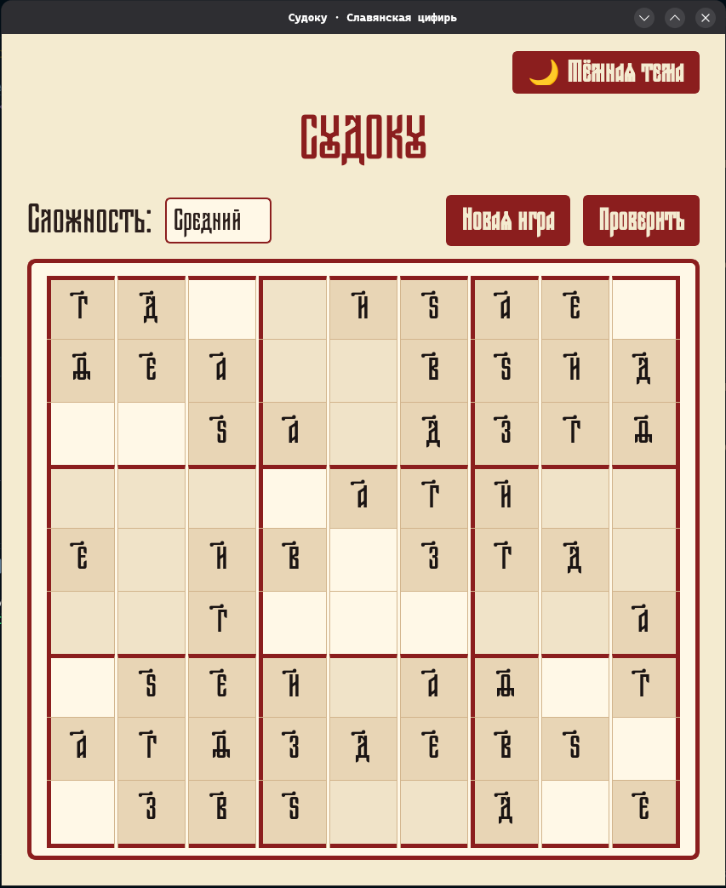
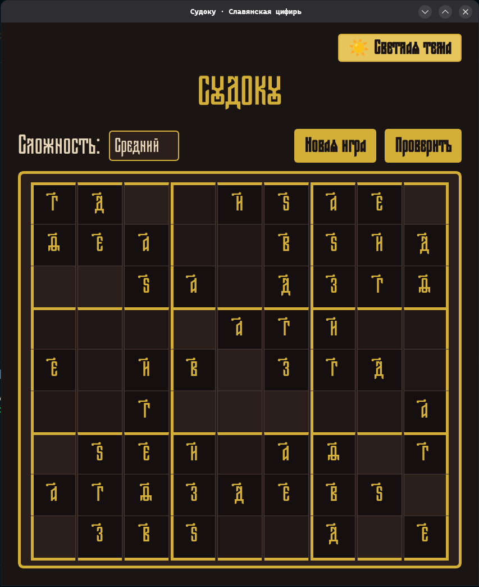

# 📜 Славянское Судоку


Уютная и стилизованная игра **Судоку**, написанная на Python с использованием библиотеки **PyQt6**. 
Вместо привычных арабских цифр здесь используется **церковнославянская цифирь** (буквицы с титлами), а интерфейс выполнен в древнерусском стиле.

## ✨ Особенности

*   **Церковнославянская цифирь**: Игровое поле использует буквицы `а҃, в҃, г҃, д҃, є҃, ѕ҃, з҃, и҃, ѳ҃`.
*   **Умный ввод**: Вводите обычные цифры `1–9` на клавиатуре, и они автоматически превращаются в славянские буквицы!
*   **Две темы оформления**:
    *   ☀️ **Светлая (Пергамент)**: Тёплые бежевые тона, имитация старинной бумаги и багряные акценты.
    *   🌙 **Тёмная (Дерево и Золото)**: Глубокие тёмные тона с золотыми границами и текстом.
*   **Чёткое разделение блоков 3×3**: Контрастные толстые границы и чередование фона (шахматный порядок) для каждого сектора.
*   **Кастомные шрифты**: Поддержка церковнославянских шрифтов (по умолчанию — `Driagwa`).
*   **Валидация**: Встроенная проверка решения. Окна ошибок и поздравлений стилизованы под текущую тему.
*   **Удобное управление**: Клавиши `Backspace` и `Delete` полностью очищают ячейку (вместе с титлом).

## 🖼️ Скриншоты





## 🚀 Установка и запуск

### 1. Клонирование репозитория
```bash
git clone https://github.com/your-username/slavonic-sudoku.git
cd slavonic-sudoku
```

### 2. Установка зависимостей
Убедитесь, что у вас установлен Python 3.8 или выше. Установите необходимые библиотеки:
```bash
pip install PyQt6
```

### 3. Настройка шрифтов (ВАЖНО!)
Для корректного отображения цифири необходимы шрифты, поддерживающие церковнославянскую графику (например, `Driagwa`, `Triodion`, `Vertograd`).

1. Создайте папку `fonts` в корне проекта (если её нет).
2. Скачайте файлы шрифтов (`.otf` или `.ttf`). Отличный источник — [Slavonic Computing Initiative](https://github.com/typiconman/fonts-cu).
3. Поместите файлы шрифтов в папку `fonts/`.

*По умолчанию скрипт ищет шрифт с именем `Driagwa`. Если вы хотите использовать другой шрифт (например, `Triodion`), измените переменную `FONT_FAMILY` в начале файла `sudoku_slavonic.py`.*

### 4. Запуск игры
```bash
python sudoku_slavonic.py
```

## 🎮 Как играть
* Выберите сложность в выпадающем списке и нажмите **«Новая игра»**.
* Выделите пустую ячейку и нажмите цифру от `1` до `9` на клавиатуре (она автоматически преобразуется в буквицу).
* Нажмите **«Проверить»**, чтобы узнать, верно ли решено судоку.
* Используйте кнопку в правом верхнем углу, чтобы переключить тему.

## 🛠️ Сборка в исполняемый файл (EXE / APP)

Если вы хотите запускать игру без установленного Python, используйте **PyInstaller**.

*Инструкция для Windows:*
```bash
pip install pyinstaller
pyinstaller --onefile --windowed --add-data "fonts;fonts" sudoku_slavonic.py
```
*(Для macOS и Linux в параметре `--add-data` используется двоеточие вместо точки с запятой: `"fonts:fonts"`)*

Готовый файл появится в папке `dist/`.

## 📝 Настройка внешнего вида
В начале файла `sudoku_slavonic.py` вынесены основные константы для быстрой настройки:
```python
FONT_FAMILY = "Driagwa"  # Имя шрифта
CELL_SIZE = 80           # Размер ячейки в пикселях
FONT_SIZE_CELL = 46      # Размер шрифта в ячейке
FONT_SIZE_TITLE = 72     # Размер заголовка
FONT_SIZE_UI = 36        # Размер шрифта интерфейса
```

## 📄 Лицензия
Этот проект распространяется под лицензией MIT. Вы можете свободно использовать, изменять и распространять его. 

Шрифты, используемые в проекте, могут распространяться под собственными лицензиями (обычно OFL или GPL). Пожалуйста, ознакомьтесь с лицензиями авторов шрифтов.
